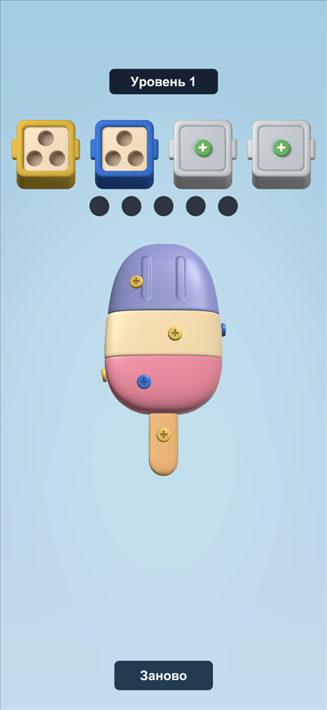
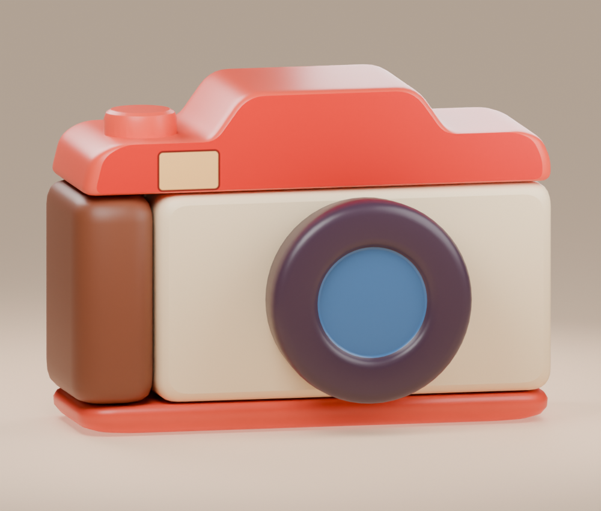
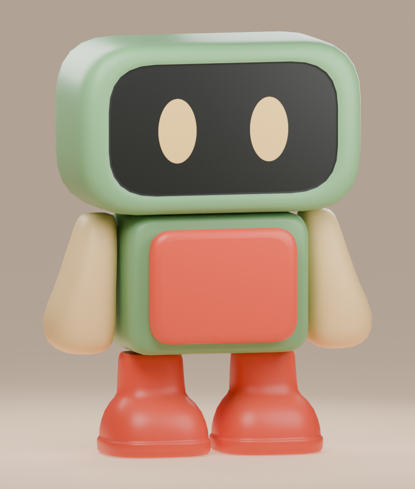
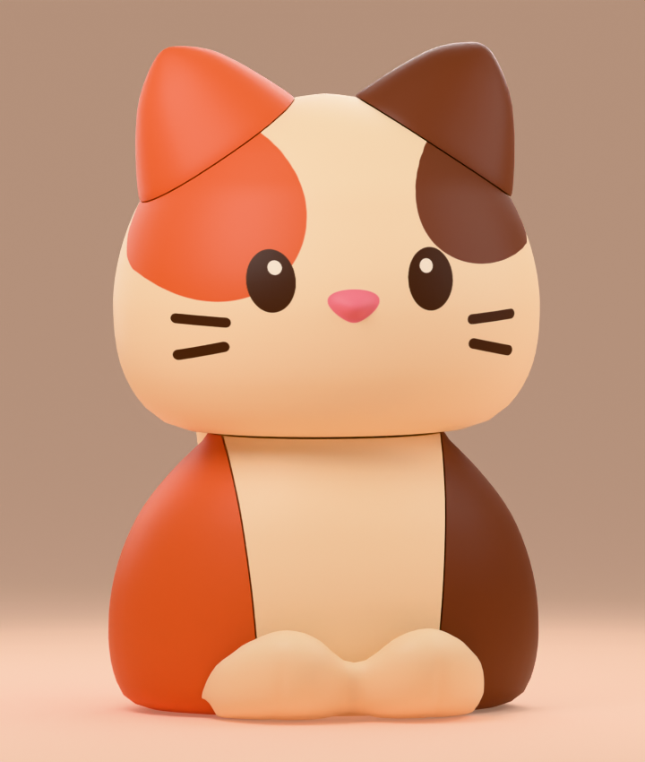

# Screw

**Портретная 3D-головоломка на Unity.** Поворачивайте фигурку, выкручивайте цветные болты и разбирайте её по частям. В кампании пять моделей, от мороженого до трёхцветного котика.

[Запуск](#быстрый-запуск) · [Кампания](#кампания) · [Разработка](#как-разрабатывался-проект) · [Документация](#документация)

  

*Первый уровень в Unity. Снимок сделан на ранней итерации оформления интерфейса.*

## Как играть

- **Перетащите модель**, чтобы повернуть её, и **нажмите на доступную головку болта**, чтобы его выкрутить. В редакторе используйте мышь, на телефоне — касания.
- Болт отправляется в контейнер своего цвета или в общий пул на пять ячеек. Заполненный контейнер закрывается и уступает место следующему по очереди. Болты подходящего цвета автоматически переходят в него из пула.
- При заполненном пуле всё ещё можно снять болт, для которого есть место в активном контейнере. Попытка снять болт, которому некуда попасть, завершает уровень поражением.
- Деталь освобождается после снятия последнего крепления. Чтобы победить, разберите всю фигурку и дождитесь, пока освобождённые детали уйдут из кадра.

## Быстрый запуск

1. Клонируйте репозиторий и добавьте его корневую папку как проект в Unity Hub.
2. Откройте проект в **Unity 2022.3.62f3** и дождитесь импорта пакетов. Для зависимостей, указанных Git URL в манифесте, нужен установленный Git.
3. Откройте сцену [`Bootstrap`](Assets/Content/Scenes/Bootstrap.unity) и нажмите **Play**. Она загрузит `Gameplay` и начнёт кампанию с первого уровня. Для работы над игровым экраном можно запускать [`Gameplay`](Assets/Content/Scenes/Gameplay.unity) напрямую.
4. В **Game View** выберите портретное соотношение сторон, например **9:16**.

Готовые уровни и коллайдеры входят в проект. Blender, Python и MCP используются при разработке и подготовке контента.

## Кампания

| Уровень | Болты | Цвета |
| --- | ---: | ---: |
| 1. Мороженое | 9 | 2 |
| 2. Будильник | 12 | 2 |
| 3. Фотоаппарат | 15 | 3 |
| 4. Робот | 18 | 3 |
| 5. Котик | 21 | 4 |

В кампании **75 болтов и 31 снимаемая деталь**. Уровни открываются последовательно, текущий можно начать заново. Порядок задаёт [`LevelContentCatalog`](Assets/Content/Settings/LevelContentCatalog.asset).

  
  
  

*Рендеры исходных моделей из Blender.*

## Как разрабатывался проект

Я разрабатывал Screw в паре с **Codex**. Я задавал требования, выбирал визуальное направление и принимал результат в Unity. Codex анализировал референс, готовил документацию и план, реализовывал согласованные задачи и помогал с проверками. Решения и статус этапов мы сохраняли в репозитории, чтобы продолжать работу между чатами.

1. **Разбор референса → геймдизайн-документ.** Я поручил Codex разобрать основную механику *Screwdom 3D* через скилл `gamedesign`. Из разбора получился GDD для MVP с правилами выбора болтов, сортировки, переполнения пула и условиями победы. [Скилл `gamedesign`](.agents/skills/gamedesign/SKILL.md) · [Геймдизайн MVP](docs/game-design/mvp.md)
2. **Геймдизайн-документ → линейный план.** На основе GDD я попросил Codex составить план через `linear-development-plan`, с зависимостями, тестами и критериями приёмки каждого этапа. Сначала мы проверили правила на изолированных сценариях, затем подключили 3D-выбор, анимации и физику на одном уровне. После этого расширили прототип до пятиуровневой кампании и добавили интерфейс и звуки. [Скилл `linear-development-plan`](.agents/skills/linear-development-plan/SKILL.md) · [План разработки](docs/development-plan/README.md)
3. **Реализация по шагам.** Скилл `task-execution` задавал порядок работы над каждой задачей — от сбора контекста и уточнения требований до реализации и проверки. Я проверял результат в Unity и давал обратную связь перед следующим шагом. Например, для перелёта болта я задал три фазы, а после проверки попросил устранить перекрытие болта моделью и интерфейсом. [Скилл `task-execution`](.agents/skills/task-execution/SKILL.md) · [Анимация и сбор болтов](docs/levels/bolt-turns.md)

### Инструменты работы с Codex

| Инструмент | Как применялся |
| --- | --- |
| **Ponytail** | Помогал выбирать минимальное полное решение и переиспользовать общие компоненты. Например, пять ячеек пула получили новый спрайт через один общий prefab. |
| **CodeGraph** | Перед изменениями Codex исследовал связи между классами и места вызовов. При правках анимации болта это помогало учитывать и обычную посадку, и перенос из пула. |
| **Context7** | Codex сверял API по документации библиотек. Например, проверял жизненный цикл VContainer и работу с последовательностями DOTween. |
| **Unity MCP и Blender MCP** | Codex использовал Unity MCP для настройки сцен и prefab, импорта и согласованных проверок в редакторе. Blender MCP применялся при подготовке и доработке моделей, а `generate-level-model` задавал порядок работы от референса до проверенного экспорта. |

Правила работы с агентом закреплены в [`AGENTS.md`](AGENTS.md). Для подготовки моделей и проверки экспорта использовался [скилл `generate-level-model`](.agents/skills/generate-level-model/SKILL.md), для проверки состава и оформления коммитов — [`git-commit`](.agents/skills/git-commit/SKILL.md).

### От модели до уровня

1. **Blender.** Фигурку собирают из отдельных мешей. Маркеры задают положение и направление болта и указывают, какую деталь он держит. Исходники, превью и отчёты о сетке хранятся в [`ArtSource`](ArtSource).
2. **Импорт в Unity.** Импортёр принимает GLB и `ModelManifest.json`, проверяет структуру и подставляет общий prefab болта. Инструменты на базе CoACD подготавливают составные коллайдеры из примитивов внутри геометрии деталей. [Инструменты коллайдеров](Tools/Colliders/README.md)
3. **Проверка разборки.** Для уровня сохраняется маршрут с углами поворота и порядком снятия болтов. Он подтверждает геометрическую доступность креплений и служит основой для раскладки цветов и интеграционных проверок. [Формат маршрута](docs/levels/spatial-route.md)

### Как устроен игровой код

| Компонент | Ответственность |
| --- | --- |
| `LevelAttempt` | Состояние попытки, резервирование ячеек, очередь цветов и условия результата. |
| `TurnCoordinator` | Согласует параллельные ходы, сортировку и ожидание падения деталей. Отменяет работу при сбросе. |
| `BoltSelection` и `LevelPartPhysics` | Выбирают доступную головку через raycast и управляют освобождением деталей после снятия креплений. |
| `BoltTurnOperations` | Выкручивание, перелёт, посадка болтов, смена контейнеров и звуки действий. |

Проект написан на **C#** и использует **URP** для рендеринга, **VContainer** и **Eflatun.SceneReference** для запуска и жизненного цикла сцен, **UniTask** и **DOTween** для асинхронных операций и анимаций, **glTFast** для импорта GLB. [Манифест пакетов](Packages/manifest.json)

## Проверки и статус

- **Edit Mode** покрывает правила сортировки, переполнение пула и валидацию данных. **Play Mode** проверяет выбор болтов, физику деталей, анимации, переходы и перезапуск. Тесты находятся в [`Assets/Content/Tests`](Assets/Content/Tests). Запуск в Unity через **Window → General → Test Runner**.
- На этапе приёмки кампании все пять уровней прошли проверку в редакторе. Интерфейс проверяли в портретных форматах **9:16**, **19,5:9 с вырезом** и **20:9**. Итоговая приёмка на физическом Android-устройстве остаётся в плане. [Статус разработки](docs/development-plan/README.md) · [Приёмка Android](docs/development-plan/p6-acceptance.md)

## Документация

| Раздел | Где читать |
| --- | --- |
| Правила игры и баланс | [Геймдизайн MVP](docs/game-design/mvp.md) · [Баланс пяти уровней](docs/game-design/generated-level-balance.md) |
| Моделирование и публикация уровней | [Blender → GLB → Unity](docs/levels/generated-level-pipeline.md) · [Форматы данных](docs/levels/README.md) |
| Сцены, игровой ход и физика | [Bootstrap и VContainer](docs/development-plan/p3-0-bootstrap-di.md) · [Координатор хода](docs/levels/turn-coordinator.md) · [Физика деталей](docs/levels/part-physics.md) |
| Этапы и результаты приёмки | [План разработки](docs/development-plan/README.md) |
